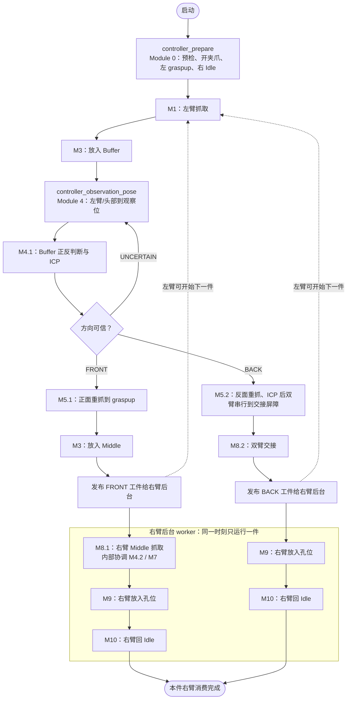

# PARM 双臂抓取、调整与放置系统

本仓库是当前实机流程的业务主线：左臂从上料区抓取工件、送入 Buffer，依据头部视觉判断
正反面；正面工件经 Middle 交给右臂，反面工件经双臂交接交给右臂；最后由右臂完成孔位放置
并回 Idle。

**真实流程的唯一入口是 [`controller/main.py`](controller/main.py)。** 旧双层总控、旧反抓
实验链和根目录 `tests/` 已不参与实机运行，不能作为入口或实现依据。

本文是系统总览，目标是让接手者理解整体边界、总控调度、左右臂并行关系和各模块职责。
每个模块内部算法、参数和独立调试方式应以该模块目录的 README 为准。

## 1. 部署的四个主目录

完整运行环境由 `/home/dainanjun/Public/` 下四个并列目录组成：

| 目录 | 定位 | 日常是否修改 |
| --- | --- | --- |
| `Parm_Grasp_Place_Loop/`（本仓库） | 业务模块、总控、视觉/抓取逻辑、标定引用和运行结果。 | 是，主要开发目录。 |
| `parm_sdk_1.0.0/` | 学校现场的本机外设服务：夹爪、力传感器、云台、free 示教踏板，以及离线 Docker 镜像。机械臂本体 driver 不在这里。 | 通常只做部署/外设维护。 |
| `parm_sdk_four_versions/` | 四份 SDK wheel 的归档，用于在本仓库 `.venv` 中明确切换学校/祥鑫、原始/改进 SDK。 | 仅在 SDK 切换或回溯时使用。 |
| `plucky_hjt_parm/` | 独立的 Docker 规划器工程，提供规划、TF 和 waypoint 服务。 | 仅在规划器、机器人模型或碰撞场景变更时修改。 |

本仓库不复制机械臂底层 driver，也不在代码中实现规划器。它通过 SDK 访问硬件服务，并通过
`plucky_hjt_parm` 提供的规划服务执行运动。

### 1.1 三个配套目录如何参与运行

这三个目录不是本仓库的子模块，但缺少其中任意一个，完整实机流程都无法正常运行：

- **`parm_sdk_1.0.0/`：本机外设层。** 学校现场由它启动夹爪、两路力传感器、头部云台和
  踏板服务；总控通过 `127.0.0.1` 的 SDK 接口访问这些服务。它还保存 Planner 所需的离线
  Docker 镜像。这里不控制机械臂本体，也不启动 Planner。
- **`parm_sdk_four_versions/`：SDK 版本档案。** 它不是运行时服务，而是四份可追溯 wheel 的
  来源。需要切换学校/祥鑫或原始/改进 SDK 时，才将选定 wheel 安装到本仓库的 `.venv`；正常
  总控运行不会读取或遍历此目录。
- **`plucky_hjt_parm/`：规划与机器人模型层。** 它以 Docker 运行 `move_group`、TF、碰撞场景
  和轨迹规划服务。总控/模块把关节或末端目标发送给它，获得轨迹后再由 SDK 下发给机械臂。
  规划器不负责业务流程、视觉判断或工件状态机。

这三个目录各自的安装、内部服务、SDK 版本和规划器配置，后续由各自目录的说明文档维护；本
README 只说明它们与业务总控之间的边界。

## 2. 本仓库结构

```text
Parm_Grasp_Place_Loop/
├── controller/                 # 唯一总控：状态机、调度、并行、停止与人工恢复
├── modules/                    # 业务模块 M0、M1、M3、M4、M5、M7、M8、M9、M10
├── tools/                      # 相机、SAM2 服务、规划运行时、标定与公共工具
├── calibration/                # 项目内标定资产与说明
├── config/                     # 顶层运行配置样例/兼容配置
├── scripts/                    # 少量人工维护脚本
├── output/                     # 模块生成的视觉、规划和调试产物（运行时）
├── .venv/                      # 本项目唯一受管理的 Python 环境
├── loop_config.py              # 共享规划/运动配置类型
└── loop_types.py               # 共享数据类型
```

其中真正决定“下一步做什么”的不是模块相互调用，而是 `controller/`：模块被视为输入、输出
明确的子进程；总控读取其统一结果后更新状态机并选择下一模块。

## 3. 运行前的服务边界

总控不负责启动外部服务。以当前学校现场（`--mode gzhu`）为例，运行前需要保持以下服务：

| 服务 | 启动位置 | 作用 |
| --- | --- | --- |
| 本机外设 driver | `parm_sdk_1.0.0/start.sh --no-web-demo` | 左右夹爪、力传感器、头部云台、踏板；正常为 5 个 driver。 |
| Planner | `plucky_hjt_parm/start_planner.sh xuexiao` | 提供规划、TF 和 waypoint 服务。 |
| SAM2 常驻服务 | `tools/sam2-service/start_uds_server.sh` | 给 Module 1 与 Module 4 提供分割/跟踪能力。 |
| 机械臂本体 driver | 控制器 `192.168.4.11` | 提供左右臂状态、使能、取消和执行接口。 |

`controller_prepare` 会对 Planner、双臂、夹爪、力传感器和 SAM2 做只读预检，但不会替代上述
服务启动。相机也不会在总控预检阶段打开：Module 1 自己打开左腕 D405，Module 4.1 自己
打开头部 D435i，避免设备竞争。

当前默认实机命令（gzhu、工件 1）为：

```bash
cd /home/dainanjun/Public/Parm_Grasp_Place_Loop

./.venv/bin/python controller/main.py \
  --mode gzhu \
  --workpiece 1 \
  --live \
  --planner-host 127.0.0.1 \
  --arm-host 192.168.4.11 \
  --gripper-host 127.0.0.1 \
  --force-host 127.0.0.1 \
  --head-host 127.0.0.1 \
  --max-buffer-observation-attempts 4 \
  --left-cycle-limit 0 \
  --prepare-speed 0.3
```

`--live` 是真实执行的显式授权；`--left-cycle-limit 0` 表示持续循环。先验证状态机而不
驱动硬件时，可使用：

```bash
./.venv/bin/python controller/main.py \
  --mode gzhu --workpiece 1 --dry-run --simulate-face FRONT
```

## 4. 部署模式与工件选择

`--mode` 是一组原子部署配置，而不只是相机标定开关。它统一导出模块子进程所需的机械臂、
夹爪、力传感器、云台地址与头部相机标定路径；只有显式命令行参数才能覆盖默认值。

| 模式 | 左腕 D405 | 头部 D435i | Arm | 本机/远端外设 |
| --- | --- | --- | --- | --- |
| `gzhu` | `260322270242` | `261222076212` | `192.168.4.11` | 夹爪、力、云台在本机 `127.0.0.1`。 |
| `xiangxin` | `260322270600` | `261722072445` | `192.168.3.11` | 夹爪在 `192.168.3.11`；力和云台在 `192.168.3.22`。 |

`--workpiece 1|2` 会同时选择该工件的 CAD、掩膜策略、ICP 初值/粗配准策略、抓取参数和
放置参数。不要只改某一个模块的工件编号而绕过总控。

## 5. 总控的职责与组成

总控只做协调，不实现抓取、ICP 或孔位插入算法。其职责是：

1. 为每个模块提供模式、工件、上游结果和服务地址等输入；
2. 读取模块统一返回，维护 Buffer、Middle、交接区和双臂状态；
3. 按规则重试、人工恢复或安全停止；
4. 让右臂消费上一件工件时，左臂尽早准备下一件；
5. 为每次运行保存可追溯的状态、结果、日志和原始模块产物。

核心文件如下。状态机、结果归一化、资源锁、失败恢复和每个文件的实现细节见
[`controller/README.md`](controller/README.md)。

| 文件 | 责任 |
| --- | --- |
| [`controller/main.py`](controller/main.py) | 入口、主循环、右臂后台任务、人工输入和停止信号。 |
| [`controller/scheduler_rules.py`](controller/scheduler_rules.py) | 纯调度规则：根据状态与模块结果决定下一模块。这里不执行机器人代码。 |
| [`controller/module_registry.py`](controller/module_registry.py) | 模块名称到真实命令、参数和硬件资源锁的集中声明。 |
| [`controller/module_runner.py`](controller/module_runner.py) | 获取资源锁、启动模块进程组、保存日志并把退出码/JSON 归一化为 `ModuleResult`。 |
| [`controller/runtime_state.py`](controller/runtime_state.py) | 持久化业务状态：Buffer、Middle、交接位、左右臂、重试计数、产物指针。 |
| [`controller/contracts.py`](controller/contracts.py) | 统一 `ModuleResult` 协议。 |
| [`controller/locks.py`](controller/locks.py) | 真实硬件资源锁：左臂、右臂、头部 D435、左腕 D405。 |
| [`controller/deployment.py`](controller/deployment.py) | 按 `gzhu/xiangxin` 写入服务地址、部署模式和头部标定环境变量。 |
| [`modules/module_0_prepare/main.py`](modules/module_0_prepare/main.py) | Module 0 的预检、开夹爪和双臂初始归位。 |
| [`modules/module_4_head_judge/observation_pose.py`](modules/module_4_head_judge/observation_pose.py) | Module 4.1 前的左臂/头部 Buffer 观察位动作。 |
| [`controller/safety.py`](controller/safety.py) | Ctrl+C/停止时向两臂发送取消任务。 |

### 5.1 一次调度循环如何运行

总控的主循环可理解为下面这一段固定协议：

```text
命令行参数
  → deployment.apply：选择现场地址、模式、头部标定并写入子进程环境变量
  → 创建 run_id、runtime 目录和空 RuntimeState
  → module_registry：根据逻辑模块名构造本次实际子进程命令
  → module_runner：获取硬件锁、运行一个子进程、收集日志/结果、标准化为 ModuleResult
  → scheduler_rules.decide：更新 RuntimeState，给出 next_module / 重试 / 人工处理
  → 回到主循环，或把右臂后半段提交为后台任务
```

`main.py` 中不硬编码任一模块文件路径、命令行参数或退出码解释；这些分别集中在
`module_registry.py` 和 `module_runner.py`。因此新增/替换模块时，应先明确它的输入、输出、
占用资源和错误语义，再修改注册表与调度规则，而不是在 `main.py` 中插入业务 `if`。

### 5.2 总控调度图：左臂主线、分支与右臂后台消费

下图是当前总控实际调度的完整主线。`controller_prepare` 和
`controller_observation_pose` 是状态机步骤名，实际入口分别是 Module 0 和 Module 4；灰色
右侧框在独立 worker 中运行，发布成功后左臂可立刻从 M1 开始下一件。



在左臂再次发布到 `Middle` 或开始下一次 M8.2 前，主线程会等待上述右臂 worker 完成；这就是
Middle 和交接区的发布屏障。Buffer 是单容量状态机工位：M1 成功后只有 `buffer=EMPTY` 才允许
进入 M3(Buffer)，不会用新件覆盖旧件。

每次调用前，总控会为该模块分配独立 `attempt` 与结果路径，并把上下文传入。典型上下文包括：

| 模块类别 | 总控传入的关键输入 |
| --- | --- |
| 所有模块 | `mode`、`workpiece`、Planner/机械臂/夹爪/力/云台服务地址、结果文件路径。 |
| M3(Buffer) | M1 成功发布的 `verified_handoff`。 |
| M3(Middle) | M5.1 成功发布的 `graspuptop` handoff。 |
| M5.1/M5.2 | 本轮 M4.1 的正反判断与 ICP TF 结果文件。 |
| M8.2 | 本轮 M5.2 生成的交接观察/位姿结果文件。 |

模块之间只通过这些显式文件和统一结果传递数据，不能隐式读取上一轮 `output/` 的“最新文件”。

### 5.3 模块输入/输出约定

每次模块调用都会产生标准结果：

```json
{
  "module": "module_4_buffer_state",
  "status": "SUCCESS | RETRY | FAULT | OPERATOR_REQUIRED | CANCELLED",
  "outcome": "模块语义结果",
  "run_id": "本轮运行 ID",
  "outputs": { "模块对下游发布的数据" },
  "error": { "失败时的结构化原因" }
}
```

总控只依据 `status`、`outcome` 与已持久化状态调度；它不会从终端文本猜测模块是否成功。
旧模块若没有原生标准结果文件，控制器会在 `controller/runtime/<run_id>/results/` 合成同一协议，
使调度层保持一致。

模块子进程的原始退出码并不直接决定调度。例如 M4.1 的 `FRONT`、`BACK`、`UNCERTAIN` 会被
统一转换为 `SUCCESS/FRONT`、`SUCCESS/BACK`、`RETRY/UNCERTAIN`；M5 的“未抓稳”转换为
`RETRY/NO_GRASP`。这样总控不会把“可重新观察”的业务失败误当作致命 Python 异常。

### 5.4 持久化业务状态，而非工位文件锁

Buffer、Middle、交接区是物理工位，用 `RuntimeState` 的持久化状态表示：

```text
Buffer:  EMPTY → LEFT_PLACING → OCCUPIED → LEFT_REGRASPING → EMPTY
Middle:  EMPTY → OCCUPIED → EMPTY
Handoff: EMPTY → LEFT_READY → TRANSFERRING → EMPTY
```

完整状态字段和调度含义如下：

| 字段 | 常见值 | 总控如何使用 |
| --- | --- | --- |
| `buffer` | `EMPTY`、`LEFT_PLACING`、`OCCUPIED`、`LEFT_REGRASPING` | 保证 M1 的新件不会覆盖 Buffer 旧件；约束 M3/M4/M5 的生命周期。 |
| `middle` | `EMPTY`、`OCCUPIED` | 表示正面件已在右臂待消费工位；非空时禁止再发布下一件到 Middle。 |
| `handoff` | `EMPTY`、`LEFT_READY`、`TRANSFERRING`、异常时 `UNKNOWN` | 表示反面件是否已由左手带到交接准备位；M8.2 只能消费 `LEFT_READY`。 |
| `left_arm` / `right_arm` | `IDLE`、`HOLDS_WORKPIECE`、`AT_HANDOFF`、`BUSY`、`FAULT` | 向调度和人工恢复明确显示哪只手可能持件或正在工作。 |
| `orientation` | `FRONT`、`BACK`、`None` | 记录当前 Buffer 工件的 M4.1 判定，便于诊断。 |
| `retries` / `attempts` | 模块或观察次数 | 分别记录业务重试预算与实际调用次数；新工件进入 Buffer 时清零。 |
| `artifacts` | 逻辑模块名 → 结果路径 | 让下游总能消费本轮上游结果，而非扫描历史输出目录。 |

这些状态不再作为短生命周期文件锁。真正需要互斥的是硬件资源，才由 `locks.py` 加锁。状态
在每次模块调用前后原子写入 `state.json`，因此子进程异常或人工等待时可以准确呈现现场；
它是诊断记录，不表示总控重启后会自动恢复运动。

### 5.5 硬件锁、后台右臂与发布屏障

每个注册模块声明它实际独占的硬件资源；`module_runner` 以固定顺序取得文件锁，再启动子进程。
当前真实资源锁为：

| 资源 | 典型消费者 |
| --- | --- |
| `LEFT_ARM` | M1、M3、M5、观察位动作、M8.2。 |
| `RIGHT_ARM` | 正面右臂复合模块、反面 M5.2（左臂到位后的右臂预抓取）、M8.2、M9、M10。 |
| `HEAD_D435` | Buffer 观察位、M4.1、M5.2、正面右臂复合模块。 |
| `LEFT_D405` | M1。 |

右臂后半段不是在主线程中串行等待，而由单个 `ThreadPoolExecutor` worker 执行。主线程在
`M3(Middle)` 成功后提交正面任务，或在 `M8.2` 成功后提交反面任务；此时左臂立即回到 M1
准备下一件。右臂 worker 自己顺序运行：

```text
FRONT worker: module_8_right_front → M9 → M10
BACK worker:  M9 → M10
```

这里有两个**发布屏障**，它们是状态机约束，不是机器人碰撞规避的替代品：

1. 左臂再次执行 `M3(Middle)` 前，必须等待上一件右臂 worker 完成；
2. 左臂开始 `M8.2` 交接前，必须等待上一件右臂 worker 完成。

因此 M1、M3(Buffer)、观察、M4.1、M5 可以与右臂放置并行，而 Middle 与交接区始终只服务
一件工件。右臂后台失败不会立即中断左臂已经启动的安全动作；主线程在合适边界收集失败、标记
`right_arm=FAULT`，再进入人工恢复。

## 6. 一件工件的完整调度流程

### 6.1 启动准备

所有业务循环之前，总控先执行 `controller_prepare`：

```text
只读服务预检
→ 打开左右夹爪
→ 左臂并行回 graspup
→ 右臂并行回 Idle
```

准备成功后，左右臂均处于可开始状态。左臂的 `graspuptop` 是 Module 1 和 Module 5.1
持件成功后的统一上游交接位；Module 3 从这里接走工件进行固定位置放置。

### 6.2 左臂公共前半段：抓取并送入 Buffer

```text
M1 左腕 D405 抓取
  → M3(Buffer) 固定放置
  → 总控移动左臂/云台到 Buffer 观察位
  → M4.1 头部 D435i 正反面 + ICP TF
```

细节如下：

1. **M1 成功**表示左手已验证持件并到达 `graspuptop`。总控只有在 Buffer 为 `EMPTY` 时
   才允许继续；否则保持左手持件并请求人工处理，绝不覆盖上一件。
2. **M3(Buffer)** 将工件放进单容量 Buffer，松爪后左臂返回 `graspuptop`/`graspup`。
3. **观察位**由总控动作完成：左臂撤到固定 Buffer 观察关节位，云台到与 gzhu 标定一致的
   观察角；然后才调用 M4.1。
4. **M4.1** 一次调用只采集一次 RGB-D，输出 `FRONT` 或 `BACK`，以及本轮对应的 ICP TF。
   该 TF 是 Module 5 抓取的唯一视觉输入。

### 6.3 正面分支：Buffer → Middle → 右臂抓取

```text
M4.1 = FRONT
  → M5.1 左臂正面重抓并回 graspuptop
  → M3(Middle) 固定放置
  → 右臂后台复合模块：M4.2 → M7 → M8.1
  → M9 右臂孔位放置
  → M10 右臂回 Idle
```

M5.1 消费 M4.1 的 ICP TF，仅负责从 Buffer 抓起并回 `graspuptop`；它不负责 Middle 放置。
M3 的 `middle` 分支负责该固定位置放置。Middle 放好后，总控把工件发布给右臂后台任务：

- **M4.2**：右侧观察工件的精确位姿；
- **M7**：必要时调整工件到右手可抓姿态；
- **M8.1**：右手从 Middle 抓取；
- **M9**：右手执行孔位放置/插入；
- **M10**：右臂回专用 Idle 位。

`M4.2 → M7 → M8.1` 在总控中视为一个“右手正面工件调整与抓取”复合模块
`module_8_right_front`；其内部闭环由 Module 8.1 的小总控完成。

### 6.4 反面分支：Buffer → 双臂交接 → 右臂放置

```text
M4.1 = BACK
  → M5.2 左臂反面重抓 + 交接观察/ICP
       1. 左臂：观察位 → 高位交接中心
       2. 左臂确认到位后，右臂：Idle → 安全预抓取位（缓存回放或 RRTstar）
     两臂到位屏障
  → M8.2 右臂从左手接取
  → 右臂后台：M9 放置 → M10 Idle
```

反面分支中，M5.2 除了按 M4.1 TF 从 Buffer 反抓，还会生成本轮交接所需的头部观察/ICP 结果，
随后先让左臂上移并确认到达高位交接中心，再启动右臂 `Idle → 安全预抓取`。右臂缓存命中时直接回放历史轨迹；未命中时，
按名义高位交接姿态以 RRTstar 规划并在关节到位后写入缓存。M5.2 只有在两臂均到位后才发布
`LEFT_READY`；M8.2 再以本轮 ICP 和实时左 TCP 执行最终 LIN 抓取。M8.2 是唯一会闭合右夹爪、
释放左夹爪并转移工件归属的模块：右手接取成功后，交接状态从
`TRANSFERRING` 变为 `EMPTY`，右臂带件进入后台 M9/M10，左臂可继续下一件。

### 6.5 左右臂并行与工位限制

右臂一旦接管工件，总控不等待它完成 M9/M10 才让左臂工作：左臂可从 M1 开始准备下一件，
并可完成 Buffer 放置、观察和 M5 重抓。

但每次只允许一个右臂后台消费任务。左臂若将要占用 **Middle**（正面 M3(Middle)）、启动
**反面 M5.2**（其 ICP 后阶段会使用右臂预抓取）或进入 **交接区**（反面 M8.2），总控会等待
上一件右臂任务完成并回 Idle。这样既允许正面前半段并行，
也不会在同一物理工位叠放或交接两件工件。

## 7. 重试、人工恢复与停止

### 自动重试

| 情况 | 总控处理 |
| --- | --- |
| M4.1 未发现唯一工件、正反不可靠或 ICP 不可靠 | 统一计入 Buffer 观察失败；默认最多 4 次。每次都先回观察位、重新采集。耗尽后将本次 Buffer 工件视为掉件/无效，清空 Buffer 状态并回 M1 抓下一件。 |
| M5.1 或 M5.2 未抓稳 | 不是直接重复抓。总控先回观察位，重新运行 M4.1 取得新的 TF，再重新运行 M5；默认最多 5 个“重新观察 + 单次重抓”闭环。 |
| M3 Buffer/Middle 放置规划失败 | 模块已在 `graspuptop` 安全松爪后返回可恢复失败。总控清理对应工位状态并回 M1；Buffer 失败不会错误清空正被右臂消费的 Middle。 |
| 右臂后台任务失败 | 左臂先完成当前已启动的安全任务；随后总控进入人工恢复，并从失败的右臂阶段重新启动。 |

### 人工恢复

无法自动确认现场状态时，控制台会显示当前 Buffer、Middle、左右臂状态并等待：

```text
y + Enter  人工处理完成后继续
q + Enter  安全退出
```

对 Buffer 观察或 M5 抓取问题，输入 `y` 后总是从**观察位 → M4.1**重新开始，禁止复用旧 ICP
TF。反抓已成功但交接准备失败时，总控保留“左手持件”状态，只允许人工确认后重试交接准备，
不能回 Buffer 重抓。M8.2 交接异常时，需先由人工把现场恢复到安全交接准备状态，才会重跑
M8.2。

### 停止

收到 `Ctrl+C`、`SIGTERM` 或 `SIGHUP` 后，总控停止发起新模块，向左右臂发送
`cancel_task()`，并终止当前模块子进程组；随后等待已经启动的右臂工作线程安全收尾。不要
通过杀掉单个模块进程代替停止总控。

## 8. 模块总览

下表只说明模块在系统中的位置。模块的具体视觉算法、轨迹、配置字段、独立运行命令和调参
规则，应查看对应 `modules/module_*/README.md`。

| 模块 | 主要职责 | 上游 / 下游 |
| --- | --- | --- |
| M0 `module_0_prepare` | SAM2、Planner、双臂、夹爪、力传感器预检；打开夹爪并使双臂回安全初始位。 | 总控的 `controller_prepare` 调度其公开入口。 |
| M1 `module_1_left_grasp` | 左腕 D405 采集、SAM2、STL/ICP、左手抓取和持件验证；成功后到 `graspuptop`。 | 上料区 → M3(Buffer)。 |
| M3 `module_3_left_place` | 左臂把已在 `graspuptop` 的工件放到固定 Buffer 或固定 Middle，并返回安全上方位。 | M1/M5.1 → Buffer/Middle。 |
| M4.1 `module_4_1_buffer_state_estimation` | 头部 D435i 对 Buffer 工件做分割、正反判断和 ICP，发布方向与 TF。 | Buffer → M5.1 或 M5.2。 |
| M4.2 `module_4_2_pose_estimation` | 右臂消费 Middle 工件前的右侧视觉位姿估计。 | 属于正面右臂复合链。 |
| M5 `module_5_left_pick` | 左臂依据 M4.1 TF 重抓：M5.1 正面回 `graspuptop`；M5.2 反面在 ICP 后先完成左臂高位交接，再完成右臂安全预抓取，并以两臂到位屏障发布交接准备。 | Buffer → Middle 或交接区。 |
| M7 `module_7_right_align` | 右臂将 Middle 工件调整到可抓取姿态。 | M4.2 后、M8.1 前；按需执行。 |
| M8.1 `module_8_1_middle_grasp` | 右臂从 Middle 抓取正面工件，内部协调 M4.2/M7 的观察和调整。 | 正面 Middle → M9。 |
| M8.2 `module_8_2_left_handoff` | 右臂从左手接取反面工件并撤离到右手放置准备状态。 | 反面交接区 → M9。 |
| M9 `module_9_right_place` | 右臂孔位放置、力控搜索与失败恢复。 | 右手持件 → M10。 |
| M10 `module_10_right_idle` | 右臂回专用 Idle 位，释放右臂对下一件的占用。 | M9 后结束一件工件的右侧生命周期。 |

目录中没有 M2、M6 是当前架构的有意结果：对应旧职责已删除或合并，不应按编号补回。

## 9. 运行产物与排查入口

每次总控运行创建唯一目录：

```text
controller/runtime/<run_id>/
├── state.json      # 最近一次持久化业务状态
├── artifacts/      # 每次模块调用的原始/标准结果文件指针
├── results/        # 控制器统一协议结果（含旧模块的合成结果）
└── logs/           # 子进程 stdout/stderr 和调度日志
```

排查实机问题时，先看该运行目录的 `state.json` 与失败模块对应的 `logs/`、`artifacts/`，再进入
模块目录查看其专属输出。不要从旧 `output/` 中任意挑选历史结果供当前流程使用。

## 10. 文档边界

本 README 维护**四个部署目录之间的系统级架构**与本仓库的总控行为。正式文档按责任边界
分层维护：

1. 本 README：四个目录的关系、系统总览、总控、左右臂流程与模块总览；
2. 每个 `modules/module_*` 目录的 README：该业务模块的详细实现、输入输出、参数与独立调试；
3. `parm_sdk_1.0.0/README.md`：本机外设服务、USB/udev、离线镜像与外设启动；
4. `parm_sdk_four_versions/README.md`：四份 SDK wheel 的身份、差异和切换方法；
5. `plucky_hjt_parm/README.md`：Planner Docker、机器人模型、规划器 Profile 与服务接口。

以下文件是独立的现场专项适配记录，不并入主架构说明：

- [`XIANXIN_SCENE_ADAPTATION.md`](XIANXIN_SCENE_ADAPTATION.md)：祥鑫现场的专项适配记录。

## 11. 新电脑的代码同步与 SAM2 权重

### 11.1 Git 同步

新电脑可以保留已传好的 `.venv`，仅用 Git 更新代码。若 GitHub HTTPS 请求被旧代理或 HTTP/2
卡住，在本仓库一次性设置：

```bash
cd /home/dainanjun/Public/Parm_Grasp_Place_Loop
git config --local http.proxy ""
git config --local https.proxy ""
git config --local http.version HTTP/1.1
```

若明确需要以远端 `main` 覆盖**已跟踪**的本地代码：

```bash
git fetch origin
git reset --hard origin/main
git status -sb
git log -1 --oneline
```

不要把 `git clean -fd` 当作日常更新命令；它会删除未跟踪的模型、标定输出或其他本地资源。

### 11.2 SAM2 bypass tracking 权重缺失

启动 `tools/sam2-service/start_uds_server.sh` 时，如果 EfficientViT 已加载但出现：

```text
checkpoint not found: .../3rdparty/efficient-sam2/bypass/ckpt/bypass_bottleneck_base.pth
```

说明缺少一个未被 Git 跟踪的 bypass 权重（约 `0.8 MB`），常见于误执行 `git clean -fd` 后。将旧电脑的
`bypass_bottleneck_base.pth` 放回：

```text
tools/sam2-service/3rdparty/efficient-sam2/bypass/ckpt/
```

然后重新启动：

```bash
cd /home/dainanjun/Public/Parm_Grasp_Place_Loop/tools/sam2-service
./start_uds_server.sh
```
