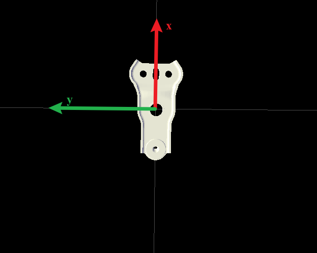
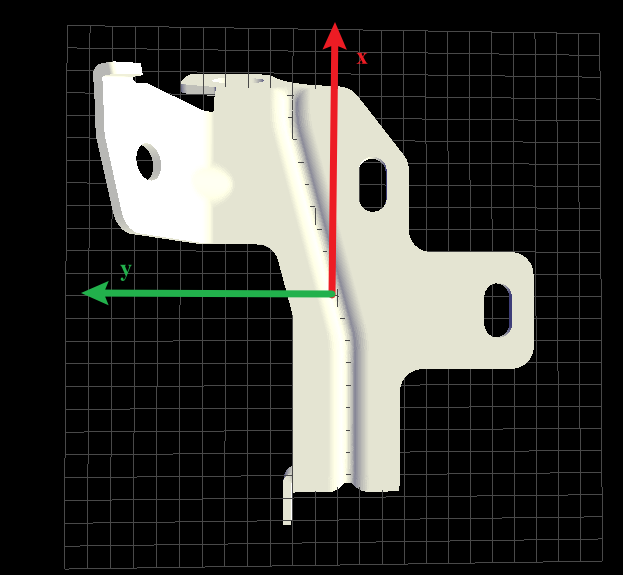

# Module 4.2：头部 RGB-D 工件 6D 位姿估计

Module 4.2 使用头部 RealSense D435i 采集 RGB-D，自动分割桌面上的工件，并将工件 CAD/STL 与观测点云做多初值全六自由度配准（6DoF ICP）。输出是工件语义坐标系在机器人 `body_base` 下的位置、姿态、head 方向、象限、正反面判断与质量指标。

它是 Module 7 右臂调整和 Module 8.1 直接抓取的视觉上游：下游读取本模块写出的 `mask_pose.json`。

## 1. 模块做什么

一次成功运行的流程如下：

```text
头部移动到已标定观察位
  → 采集并中位数融合 RGB-D
  → 深度转逐像素 XYZ 点云
  → RANSAC 拟合桌面平面
  → 以“高于桌面 + 暗色 + 桌面 ROI”产生 SAM2 正提示
  → SAM2 分割工件 mask
  → mask 内点云与 STL 做 FPFH/RANSAC 全局配准
  → 多种语义半转初值做点到平面 ICP 精修
  → 用桌面法线和可见深度评分判定 FRONT/BACK/OTHER（正反识别）
  → 写出正式结果与元数据
```

RGB-D 并不只用于 SAM2 提示：mask 内的深度点云是 ICP 的观测目标，真实深度也用于对 CAD 候选姿态评分。

## 2. 入口与运行方式

入口脚本：

```text
tabletop_pointcloud_workpiece_pose.py
```

先查看参数（不会连接硬件）：

```bash
python3 /home/dainanjun/Public/Parm_Grasp_Place_Loop/modules/module_4_head_judge/module_4_2_pose_estimation/tabletop_pointcloud_workpiece_pose.py --help
```

完整运行工件 1：

```bash
python3 /home/dainanjun/Public/Parm_Grasp_Place_Loop/modules/module_4_head_judge/module_4_2_pose_estimation/tabletop_pointcloud_workpiece_pose.py \
  --workpiece 1
```

完整运行工件 2：

```bash
python3 /home/dainanjun/Public/Parm_Grasp_Place_Loop/modules/module_4_head_judge/module_4_2_pose_estimation/tabletop_pointcloud_workpiece_pose.py \
  --workpiece 2
```

脚本会自动重启到项目的 `.venv/bin/python`；该环境需要具备 `opencv-python`、`open3d`、`pyrealsense2` 和 `parm_sdk`。


## 3. 配置与资产

### 3.1 头部相机标定文件

默认标定文件为（在学校时的标定）：

```text
calibration/sdk_base_to_planner_alignment.json
```

它提供相机内参、畸变系数、SDK base 与 `body_base` 的对齐关系，以及由该关系得到的头相机到 `body_base` 的外参。脚本会读取其中的：

- 彩色相机内参 `camera_matrix`；
- 畸变系数 `distortion_coeffs`；
- 相机到机器人基座的外参 `T_body_base_head_camera`；
- 标定图像分辨率。


```text
这个标定文件对应相机低头38.5°，扭头0°，即pitch=38.5°，yaw=0°；如果云台不是这个姿态，则位姿估计会不准。
```

脚本会拒绝“沿用默认标定但修改头部 pitch/yaw”的组合。若要使用其他观察位，必须提供该观察位重新标定得到的 `--calibration` 文件。

目录中还保留 `calibration/head_charuco_13x5_calibration_head.json`，它对应另一套相机/观察位标定，**不是当前默认标定**。若显式使用它，必须同时提供它对应的头部 pitch/yaw。换场景、相机或观察位必须重新标定，否则位姿估计不准。

### 3.2 工件 STL 与语义坐标系

STL 天然有一套“文件自身坐标系”：STL 原始 X / Y / Z。但我们使用的话需要人工定义“怎样算工件正面、哪里是工件头和尾”等，所以需要一个“工件语义坐标系”，json文件的作用就是“我们希望使用的'工件语义坐标系'，与 STL 原始坐标系之间如何转换”。

公式为p_stl = T_stl_workpiece_semantic × p_semantic。

这样，不管不同 STL 建模时轴向怎么放，下游 Module 7、Module 8.1 和视觉输出都能使用统一语义。

语义坐标系涉及到module 4_2位姿估计出的工件中心点、工件在桌面的象限、朝向（+x轴方向），而中心点又关系到 module 7 和 8_1 的抓取点、预抓取点，这两类点都是基于“工件中心点”算出来的，在配置文件toml里定义的是基于工件中心点沿着工件语义坐标系的偏移量。

以 module 7 里工件1为例，抓取点1的参数为[0.0, 0.0, 0.02830022645]，意思是抓取点xy=工件中心点，抓取点z是在工件中心点沿着工件+z偏移0.02830022645m。此外，[x, y, z]三个偏移量都是沿着工件语义坐标轴方向的，对于工件2来说，它放在桌面上是倾斜状态，[-0.03, 0, 0]就代表抓取点是在中心点沿着工件 -X 偏移3cm（y和z都会跟着变）

`--workpiece` 选择一组默认资产：

| 参数 | STL | 语义 JSON |
|---|---|---|
| `--workpiece 1` | `assets/workpiece_1/workpiece_1.stl` | `assets/workpiece_1/workpiece1.semantic.json` |
| `--workpiece 2`（默认） | `assets/workpiece_2/workpiece_2.stl` | `assets/workpiece_2/workpiece2.semantic.json` |

可用 `--stl` 与 `--semantic-calibration` 覆盖，但两者必须属于同一工件语义定义。

语义 JSON 至少定义：

```json
{
  "transform_convention": "p_stl = T_stl_workpiece_semantic @ p_workpiece_semantic",
  "positive_face": { "upward_axis": "+Z" },
  "T_stl_workpiece_semantic": [[...], [...], [...], [...]]
}
```

语义含义：

- `+X`：由 tail 指向 head；输出 yaw 和 Q1–Q4 的基准；
- `+Y`：工件局部左侧；
- `+Z`：正面外法线；当它指向桌面上方时，该面定义为 `FRONT`；
- `T_stl_workpiece_semantic`：把语义点转换到 STL 点坐标的 4×4 刚体变换。

工件 1 当前为单位变换，即 STL 的原始方向恰好符合我们要求的“tail→head / 左侧 / 正面朝外”定义，STL +X = 语义 +X、
STL +Y = 语义 +Y、STL +Z = 语义 +Z。原点的z不在工件中心，而在中心的下方，详见stl。


工件 2 的语义坐标相对 STL 在 X/Y 方向翻转，STL X = -语义 X、STL Y = -语义 Y、STL Z =  语义 Z。


不要将两个工件的 STL 与语义 JSON 交叉混用。

### 3.3 环境变量和服务

| 环境变量 | 用途 | 默认值 |
|---|---|---|
| `POSE_ESTIMATION_PYTHON` | 运行脚本的 Python | 项目 `.venv/bin/python` |
| `PARM_HEAD_HOST` | 头部服务地址 | `localhost` |
| `POSE_ESTIMATION_SAM2_SOCKET` | SAM2 Unix socket | `tool/sam2-service/runtime/sam2-service.sock` |
| `POSE_ESTIMATION_SAM2_BIN` | SAM2 服务可执行文件 | `tool/sam2-service/.venv/bin/sam2-service` |

若 SAM2 socket 尚不存在，脚本会尝试启动常驻的 `sam2-service`。服务启动/推理失败时，本模块不会得到有效 mask。

## 4. 采集与 SAM2 分割

### 4.1 RGB-D 采集

默认采集参数为 `1280×720 @ 30 FPS`。深度先对齐到彩色图，再对默认 15 帧逐像素取中位数，以降低深度噪声。随后根据相机内参将每个深度像素换算为相机坐标系 XYZ 点。

完整深度和点云数据保存在 `rgbd.npz`：

- `rgb`：BGR 彩图；
- `depth_raw`：融合后的原始 z16 深度；
- `xyz_m`：逐像素相机坐标系点云，单位米；
- `intrinsics`、`depth_scale_m`、`serial`、`timestamp_unix_s`。

### 4.2 桌面与种子

脚本对全部有效深度点做 3 mm 体素降采样，再使用 Open3D RANSAC 拟合桌面平面：

```text
ax + by + cz + d = 0
```

默认平面内点距离阈值为 4 mm，迭代 1200 次。使用该平面计算每个点高于桌面的有符号高度。

平面法线 `(a, b, c)` 即本次观测的 `table_up_normal_camera`：它位于**头部相机坐标系**，并被统一定向为从桌面指向相机一侧，可理解为“桌面朝上”。它不是固定常量；每次新的 RGB-D 采集（包括 LOW 重拍和 BACK 确认拍摄）都会重新拟合。同一次 RGB-D 图中的多个工件共用该次拟合得到的桌面法线。

原始种子满足以下全部条件：

```text
深度有效
∧ 位于桌面 ROI
∧ 高出桌面 ≥ 10 mm
∧ 灰度值 ≤ 90（0–255）
```

种子经 3×3 开运算和 5×5 膨胀后，连通域面积至少 90 px 才成为候选工件。每个候选区域使用最多 3 个分散的正提示点调用 SAM2：先选中心附近一点，再按最远点采样选择其余点，避免提示点聚集在同一位置。

SAM2 对每个候选区域单独分割，只保留包含提示点的连通部分；单个 mask 小于 350 px 则丢弃。合并后的 mask 再按连通域拆开，面积至少 500 px 的区域才会进行姿态估计。

关键参数：

| 参数 | 默认值 | 含义 |
|---|---:|---|
| `--seed-height-mm` | 10 | 高于桌面的最小高度 |
| `--seed-max-gray` | 90 | 种子像素最大灰度 |
| `--min-seed-area` | 90 px | 产生 SAM2 提示的最小种子面积 |
| `--min-mask-area` | 350 px | 接受单个 SAM2 mask 的最小面积 |
| `--min-pose-area` | 500 px | 进入 ICP 的最小最终连通域面积 |
| `--roi` | 梯形 ROI，换场景后根据实际情况调整 |

## 5. CAD 点云配准与位姿输出

对每个最终 mask，脚本将 mask 内的 `xyz_m` 点作为观测点云，STL 表面采样点作为 CAD 点云。

### 5.1 全局初值：FPFH + RANSAC

先对 CAD 点云和观测点云计算 FPFH 局部几何特征；再用 RANSAC 从特征对应关系中估计粗略刚体变换：

```text
p_camera ≈ R × p_stl + t
```

默认使用 16 个确定性 RANSAC seed；每个 seed 最多 100000 次迭代。该阶段负责解决“CAD 大概在哪里、朝向哪里”。

### 5.2 ICP 精修与语义翻转候选

每个 RANSAC 初值并非只跑一次 ICP，而是派生四个语义旋转候选：

```text
原始方向
语义 X 轴旋转 180°
语义 Y 轴旋转 180°
语义 Z 轴旋转 180°
```

因此默认最多运行：

```text
16 个 RANSAC 初值 × 4 个语义候选 = 64 次 ICP
```

每次 ICP 是点到平面 ICP，默认 45 轮、最大对应距离 9 mm，并使用 Tukey 鲁棒损失。它负责在粗姿态附近得到更精确的 6D 变换。

候选还必须满足：

- 工件语义原点投影在当前 mask 内；
- CAD 表面不得穿入桌面超过默认 10 mm；
- 有足够有效观测点（至少 120 点）。

### 5.3 可见深度评分

仅有 ICP RMSE 不足以可靠区分工件的正反面。脚本会将候选姿态下的高密度 CAD 点投影回相机图像，用 z-buffer 保留每个像素最前面的 CAD 表面，再与真实 mask 深度比较：

```text
综合评分 = 可见表面深度误差 + CAD/mask 轮廓不重叠惩罚
```

分数越低，表示该候选从相机视角看越像真实采集到的工件。

## 6. FRONT / BACK / OTHER 的判定

语义 JSON 的 `positive_face.upward_axis` 定义正面外法线。ICP 得到工件姿态后，脚本将该局部法线旋转到相机坐标系，得到 `positive_face_normal_camera`。`table_up_normal_camera` 则是本次 RGB-D 点云实时拟合桌面平面得到的朝上法线；两者都在相机坐标系，因此可以直接计算点积：

```text
dot = positive_face_normal_camera · table_up_normal_camera
```

这里不是将“工件法线的 body_base 表示”与“桌面法线的相机表示”混合计算。若两条法线都先经相机外参旋转到 `body_base`，点积会保持不变；当前代码留在相机坐标系，是因为 ICP 和桌面平面拟合都直接在该坐标系完成。

默认 `--minimum-z-up-dot=0.90`：

| 条件 | 含义 |
|---|---|
| `dot ≥ +0.90` | 当前候选可作为 `FRONT` 候选 |
| `dot ≤ -0.90` | 当前候选可作为 `BACK` 候选 |
| 中间范围 | 该候选不能代表明确正/反面 |

脚本会在 FRONT 与 BACK 候选中各自选取深度评分最低者。若两者分数相差至少 `--minimum-face-margin-mm`（默认 0.35 mm），则较低分的一侧成为最终 `FRONT` 或 `BACK`；差距不足或缺少足够对比证据时，输出 `OTHER`。

因此，点积用于限定“朝上/朝下的候选类别”，深度渲染评分用于判断两种类别中哪种更符合真实观测。

## 7. 位姿估计置信度、重拍和 BACK 确认

每个工件输出 `pose_confidence`：

- `HIGH`：点数、ICP fitness、RMSE、深度评分、正反面分差和候选一致性都达到严格阈值；
- `MEDIUM`：没有 LOW 原因，但未达到 HIGH 的全部条件；
- `LOW`：存在模糊正反、点数不足、fitness 低、RMSE/深度评分过大或近似最优候选差异过大等问题。

默认 `--low-confidence-retries=2`。因此 LOW 时会重新进行完整 RGB-D 采集、分割和配准，最多：

```text
首次 + 2 次额外重拍 = 3 次完整尝试
```

若全部尝试都只能得到 LOW，模块仍会发布其中“最不差”的结果，并在 `metadata.json` 中写入：

```json
"confidence_fallback_used": true
```

若一次结果中所有工件（一般桌上只会有1个工件）均为 `BACK`，模块会额外拍摄一次作独立确认；两次都是 BACK 才正式发布，并选取 ICP 综合指标更好的那一次。

## 8. 输出目录和文件

结果写入：

```text
output/module_4_2/workpiece_<编号>/<递增序号>/
```

正式发布目录包含：

| 文件 | 内容 |
|---|---|
| `rgb.png` | 本次 RGB 图像 |
| `rgbd.npz` | 融合深度、逐像素 XYZ、内参与深度比例 |
| `seed_raw.png` | 未清理的几何种子 |
| `seed_cleaned.png` | 形态学清理后的种子 |
| `seed_prompts.png` | 种子与 SAM2 正提示点调试图 |
| `mask.png` | 最终 SAM2 二值 mask |
| `rgb_icp_workpiece_frame.png` | RGB 上的 ROI 和 ICP 语义坐标系调试图 |
| `mask_pose.json` | 下游使用的工件位姿结果 |
| `metadata.json` | 采集、头部动作、平面、种子、SAM2、重试等元数据 |

不会再生成 `depth_aligned.png` 或 `mask_pose.png`。

## 9. `mask_pose.json` 的关键字段

顶层字段：

- `workpiece_asset`：工件编号；
- `stl`、`semantic_calibration`：本次实际使用的资产；
- `coordinate_frame: "body_base"`；
- `workpieces`：按 mask 面积从大到小排列的工件数组；
- `rejected_components`：未能形成有效 ICP 位姿的连通域及原因。

每个 `workpieces[i]` 中，下游常用字段为：

| 字段 | 含义 |
|---|---|
| `orientation` | `FRONT`、`BACK` 或 `OTHER` |
| `head_direction_base_angle_deg` | 语义 tail→head 在 `body_base` XY 平面的 yaw，范围 `[0, 360)` |
| `head_direction_base_quadrant` | 该 yaw 对应的 Q1–Q4 |
| `pose_body_base` | 工件语义原点的 xyz、RPY 和旋转矩阵 |
| `T_body_base_workpiece_semantic` | 完整 4×4 语义位姿矩阵 |
| `icp` | RMSE、fitness、深度评分、观测点数、正面法线点积等 |
| `face_hypotheses` | FRONT/BACK 最佳候选的评分信息 |
| `candidate_confidence` | 同侧近似最优候选的一致性诊断 |
| `pose_confidence` | HIGH/MEDIUM/LOW 和具体原因 |

当前 Module 8.1 总控使用 `orientation`、`head_direction_base_quadrant`、`head_direction_base_angle_deg`；Module 7 使用完整工件位姿及方向字段。`workpiece-index` 必须与下游目标工件在此数组中的索引一致。

## 10. 常用参数覆盖示例

使用另一份匹配观察位的标定：

```bash
.../tabletop_pointcloud_workpiece_pose.py \
  --workpiece 1 \
  --calibration /absolute/path/to/calibration.json \
  --head-pitch-deg <pitch> \
  --head-yaw-deg <yaw>
```

使用指定的 CAD 与语义文件：

```bash
.../tabletop_pointcloud_workpiece_pose.py \
  --workpiece 1 \
  --stl /absolute/path/to/workpiece.stl \
  --semantic-calibration /absolute/path/to/workpiece.semantic.json
```

调整种子过滤（应先查看 `seed_*.png`，再小步调整）：

```bash
.../tabletop_pointcloud_workpiece_pose.py \
  --workpiece 1 \
  --seed-height-mm 8 \
  --seed-max-gray 100
```

## 11. 排障顺序

出现位姿、正反面或分割问题时，建议依次检查：

1. 头部是否到达与外参匹配的观察位；
2. `rgb.png` 是否清晰、工件是否完整可见；
3. `seed_raw.png` 和 `seed_cleaned.png` 是否覆盖工件且未引入大面积背景；
4. `seed_prompts.png` 的红点是否位于各工件内部；
5. `mask.png` 是否完整且只覆盖目标工件；
6. `rgb_icp_workpiece_frame.png` 中的语义坐标轴是否正确、是否误拍摄到其他背景；
7. `mask_pose.json` 的 `icp`、`face_hypotheses`、`candidate_confidence` 和 `pose_confidence.low_reasons`；
8. `metadata.json` 中的 `head_move`、桌面平面、SAM2 诊断和 `confidence_fallback_used`。

不要仅通过放宽 ICP 阈值来掩盖错误标定、错误 STL/语义 JSON 或错误 mask；这些问题会使下游机械臂使用错误的物理位姿。
